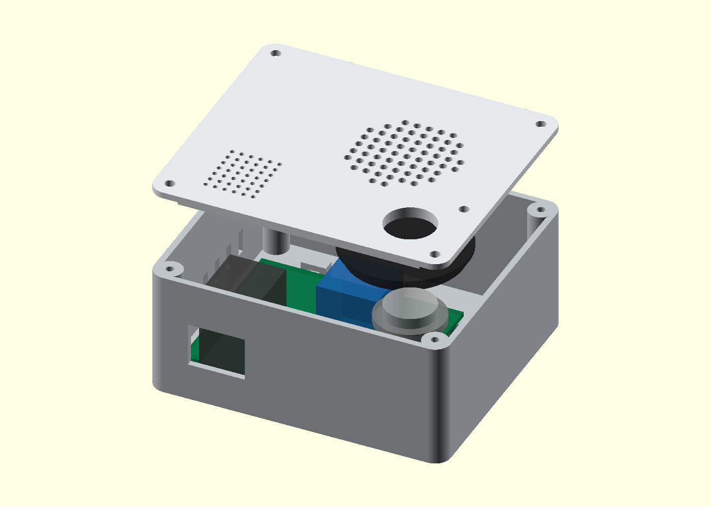

# Mesa Voice R1

Asistente de voz de sobremesa con botón para hablar, micrófono PDM, Wi-Fi, altavoz de 8 Ω y alimentación USB-C. Se conecta a un servidor Python local con faster-whisper, Ollama y Piper. El modo mock devuelve un tono para comprobar el transporte.

**Estado: entrega digital para un primer prototipo experimental, aún no construido.** La portadora pasa ERC y DRC con paridad esquema/PCB, sin conexiones pendientes. El firmware completo compila y enlaza para ESP32-S3; el backend pasa 41 pruebas y una petición HTTP real en localhost. Los tres STL son mallas cerradas y pasan la comprobación de interferencias nominales modeladas. No se ejecutó inferencia con modelos reales ni se probaron componentes físicos. Leer el [informe de validación](docs/validation.md) antes de fabricar.



## Entregables

| Carpeta / archivo | Contenido |
|---|---|
| `hardware/mesa-voice.kicad_pro` | Proyecto KiCad 9.0.6, esquema y PCB portadora propia de 64×54 mm, dos capas |
| `hardware/wiring.kicad_pro`, `wiring.kicad_sch` | Proyecto independiente de cableados del botón, LED y altavoz; seis conexiones verificadas |
| `hardware/Mesa.pretty`, bibliotecas `.kicad_sym` | Huellas y símbolos locales incluidos |
| `hardware/fabrication/` | Gerber X2, perforación PTH/NPTH, mapas, IPC-2581 y manifiesto con hashes |
| `hardware/mesa-voice-r1-fabrication.zip` | Paquete de fabricación generado sólo después de pasar comprobaciones |
| `hardware/previews/` | Vistas SVG y PNG del esquema, cobre y montaje |
| `hardware/references/` | Esquemas de los módulos de fabricante y atribución |
| `mechanical/` | CAD paramétrico OpenSCAD, tres STL y vistas de inspección |
| `firmware/` | Código ESP32-S3, configuración PlatformIO y pruebas C++ del protocolo |
| `backend/` | Servidor Python ejecutable, adaptadores locales y tests |
| `BOM.csv` | Lista consolidada con cantidades, referencias y especificaciones |
| `docs/` | Arquitectura, ensamblaje, mecánica, firmware, protocolo y validación |
| `validation/` | Informes originales, logs y plantilla para pruebas físicas |
| `tools/` | Generadores y verificaciones reproducibles |

La placa integra mediante zócalos un **Seeed XIAO ESP32S3 Sense 113991115** y un **Adafruit MAX98357A 3006**. Es una portadora personalizada, no un rediseño de sus circuitos RF/USB/MEMS internos. Usa cámara retirada y expansión Sense conectada. Caja cerrada 94×82×42 mm. No tiene wake word ni cancelación de eco.

## Probar el servidor sin hardware ni modelos

Python 3.12; desde `backend/`:

```powershell
python -m venv .venv
.\.venv\Scripts\Activate.ps1
python -m pip install -r requirements-dev.txt
python -m pytest -q
$env:MESA_TOKEN = (python -c "import secrets; print(secrets.token_hex(24))")
$env:MESA_MODE = 'mock'
python -m uvicorn mesa_voice.app:create_app --factory --host 127.0.0.1 --port 8000 --workers 1 --no-access-log
```

En otra terminal con el mismo token: `python -m scripts.smoke_client --output reply.wav`. Para una prueba autocontenida que inicia y detiene un servidor temporal, desde la raíz y con esas dependencias: `python tools/check_transport.py`. Sólo usa localhost y un token efímero.

Para modelos reales seguir [backend/README.md](backend/README.md). No se incluyen pesos, voces, credenciales ni descargas implícitas de modelos durante consultas. Para conectar el ESP32 configurar IP del PC y token en `firmware/include/secrets.h`; consultar [docs/firmware.md](docs/firmware.md). HTTP es adecuado únicamente para esta LAN de confianza; no publicar el servicio.

## Reproducir archivos técnicos

Abrir directamente el proyecto KiCad y el archivo OpenSCAD es suficiente para editarlos. Los generadores necesitan Python de KiCad con `pcbnew` y NumPy; no sirve un `pip install pcbnew` cualquiera. En Windows, KiCad 9 incluye `bin/python.exe`.

```powershell
# Desde la raíz del repositorio, con rutas adaptadas a la instalación:
& 'C:/Program Files/KiCad/9.0/bin/python.exe' tools/generate_hardware.py
python tools/generate_wiring.py
python tools/make_bom.py
python tools/release_hardware.py --kicad-cli 'C:/Program Files/KiCad/9.0/bin/kicad-cli.exe'
& 'C:/Program Files/KiCad/9.0/bin/python.exe' tools/check_interfaces.py
python -m pip install trimesh==4.6.8 numpy==2.2.6
python mechanical/export.py --openscad 'C:/Program Files/OpenSCAD/openscad.exe' --render
```

`generate_hardware.py` regenera esquema y PCB y reemplaza ediciones manuales; elegir editar fuente o CAD y conservar esa decisión. `generate_wiring.py` debe ejecutarse después, pues agrega la biblioteca de cableado. El trazado es determinista en geometría; los UUID y fechas de archivos KiCad pueden cambiar. El manifiesto corresponde a los archivos concretos incluidos, no a una promesa de igualdad binaria entre regeneraciones.

Para validar el firmware: `pip install platformio==6.1.18` y `python tools/build_firmware.py`. En Windows usar una ruta corta de caché con `--core-dir C:/ruta/corta/pio`. Las credenciales de esa compilación son ficticias y públicas; para tu dispositivo configurar y compilar el entorno `mesa_voice` como indica [firmware.md](docs/firmware.md). Plataforma, framework y toolchain están fijados. `.github/workflows/check.yml` prepara verificación en Ubuntu, **pero no se publicó ni ejecutó un workflow remoto**. El test C++ de host sí se compiló y ejecutó localmente.

El ZIP de fuentes omite cachés, entornos virtuales, credenciales y binarios de terceros. Incluye el código y la evidencia de compilación con hashes; el firmware de uso se genera con tu SSID y token. `tools/package_release.py` comprueba la vigencia de los informes y crea el ZIP y su SHA256. Consultar [reproducibilidad](docs/reproducibility.md) para los comandos completos.

## Fabricar y ensamblar

Seguir [docs/assembly.md](docs/assembly.md), [docs/mechanical.md](docs/mechanical.md) y la BOM. Hacer una revisión 1:1 de huellas contra los módulos recibidos antes de fabricar la primera placa. No se realizó ninguna compra ni se envió nada a fabricantes.

Los datos eléctricos de diseño, fuentes y riesgos están en [arquitectura](docs/architecture.md), [fuentes](docs/sources.md) e [informe de validación](docs/validation.md). El siguiente paso es preparar el servidor y sus modelos, configurar las credenciales del firmware y montar una unidad para completar la tabla de aceptación física. Esta revisión usa pulsar para hablar; no incluye activación por palabra.
