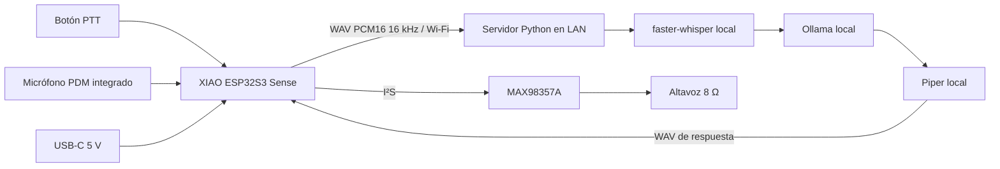

# Arquitectura y decisiones — Mesa Voice R1

Prototipo de sobremesa, 94 × 82 × 42 mm, con una PCB portadora propia de 64 × 54 mm, dos capas y montaje manual. La portadora interconecta módulos de fabricante: **no es una placa ESP32, RF y MEMS diseñada a nivel de silicio desde cero**. Se eligió esta arquitectura para reducir riesgos de antena, soldadura MEMS y USB y hacer viable un primer montaje. Las librerías y el trazado de la portadora sí se diseñaron para este proyecto.

## Cadena funcional

Se mantiene pulsado para grabar, se suelta para consultar y se escucha la respuesta. Semidúplex, 8 s de entrada y 20 s de salida. No hay wake word, cancelación de eco, historial, domótica ni ejecución de herramientas. El prototipo admite preguntas habladas; no promete la experiencia acústica de un producto comercial.

## Electrónica

| Bloque | Elección | Motivo / condición |
|---|---|---|
| MCU, red y micrófono | Seeed XIAO ESP32S3 Sense, 113991115 | Wi-Fi 2,4 GHz, 8 MB PSRAM, USB-C nativo y PDM integrado. Cámara retirada; placa Sense permanece conectada. |
| Amplificación | Adafruit 3006, MAX98357A | Entrada I²S a lógica 3,3 V, alimentación 5 V, sin MCLK ni configuración I²C. |
| Altavoz | Visaton K40, art.2840 | 8 Ω, 1 W, Ø40 mm, profundidad 4,3 mm; voz de escritorio. |
| Mute | BSS138LT1G + R3 100 kΩ | R3 eleva puerta a 3,3 V; GPIO4 alto hunde SD_MODE. No se conecta el GPIO al pull-up de 5 V del módulo. |
| Ganancia | R4 100 kΩ entre GAIN y VIN | Selección de 3 dB del MAX98357A. Firmware atenúa PCM a 1/4. |
| Alimentación del amplificador | F1 MF-MSMF050-2 + C1 100 nF | PTC 0,5 A de mantenimiento a 23 °C en la rama del amplificador. El módulo incorpora 10 µF y 100 nF. |
| Controles | PTT con R1 10 kΩ / C2 100 nF; LED con R2 1 kΩ | Pulsador NO, entrada activa baja. Filtro RC de 1 ms más debounce de software 30 ms. |
| Interfaz I²S | R5–R7 33 Ω | Amortiguación serie de BCLK, LRCLK y DIN, cerca de la salida MCU. |

Los pines detallados están en [firmware.md](firmware.md) y en el esquema. GPIO3, GPIO0 y GPIO45/46 no se usan para estas señales. USB GPIO19/20 queda reservado. GPIO43 se usa para DIN y no puede utilizarse como UART simultáneamente. GPIO41/42 corresponden al micrófono en la expansión Sense.

La entrada USB-C, sus resistencias CC, la regulación 3,3 V, la flash y el circuito del micrófono pertenecen a U1. La conversión y la salida BTL pertenecen a U2. Sus esquemas originales se enlazan en [sources.md](sources.md). El esquema de la portadora y `wiring.kicad_sch` cubren todas las conexiones añadidas por este proyecto.

## Presupuesto eléctrico de diseño, no medido

Alimentación única: cargador USB regulado 5 V, capacidad mínima 1 A, cable corto de datos para programar. No requiere negociación USB-PD. El diseño **no mide el anuncio de corriente CC** y no acredita cumplimiento USB-IF; para uso normal se especifica cargador dedicado, no un puerto de ordenador como fuente genérica. Retirar U2 durante las primeras cargas desde un PC.

Se reserva un presupuesto de 350 mA para picos de U1 y 100 mA para U2 con el volumen inicial, aproximadamente 450 mA de conjunto. Es una hipótesis de dimensionamiento que debe medirse; no es un límite impuesto por hardware. F1 no limita instantáneamente a 500 mA: su disparo depende de corriente y temperatura. La fuente debe tener protección de sobrecorriente propia. F1 protege sólo la rama del amplificador.

Las pistas de 5 V son de 0,60 mm; 3,3 V y GND de 0,40 mm; señales de 0,25 mm. Cobre 35 µm, separación mínima 0,20 mm. Como orden de magnitud, 50 mm de pista de 0,60 mm presentan unos 0,04 Ω a temperatura ambiente, además de vías y conectores. El PTC puede añadir hasta 1 Ω después de disparar; a 100 mA eso supone 0,1 V de caída. Validar VBUS durante Wi-Fi y reproducción.

No hay batería conectada. No alimentar los pads BAT ni el pin de 5 V por otra fuente. Ambos terminales del altavoz son activos BTL; ninguno va a GND, auriculares, osciloscopio con pinza de masa ni entrada de línea. Para medir salida usar sonda diferencial o dos canales y resta con ambas masas en GND.

## PCB y mecánica

Las dos filas U1 son 1×7 a 2,54 mm, separadas 15,24 mm, con USB hacia Y negativa. U2 tiene una fila de siete pines y dos agujeros Ø2,7 mm para separadores de nailon. Las salidas al altavoz salen directamente de su bornera y no recorren la portadora. La cara inferior tiene plano GND relleno además de pistas de masa conectadas. No hay RF ni pares USB en la portadora.

La carcasa tiene base, tapa y aro retenedor separados. El altavoz queda mecánicamente retenido sobre una junta; el micrófono tiene otra rejilla. La antena FPC se coloca en pared trasera de plástico, separada del borde de PCB. Esto es una reserva geométrica, no una validación de radiación o adaptación de antena. Ver [mechanical.md](mechanical.md).

## Software

El dispositivo conserva ambos WAV en PSRAM y envía una petición HTTP con token. El backend limita tamaños, serializa peticiones y aplica plazos; faster-whisper y Piper se ejecutan en subprocesos cancelables. Ollama se restringe a loopback. El modo mock devuelve un tono, por lo que prueba transporte y reproducción sin simular comprensión. HTTP no cifra el tráfico; la revisión está destinada a LAN de confianza.
